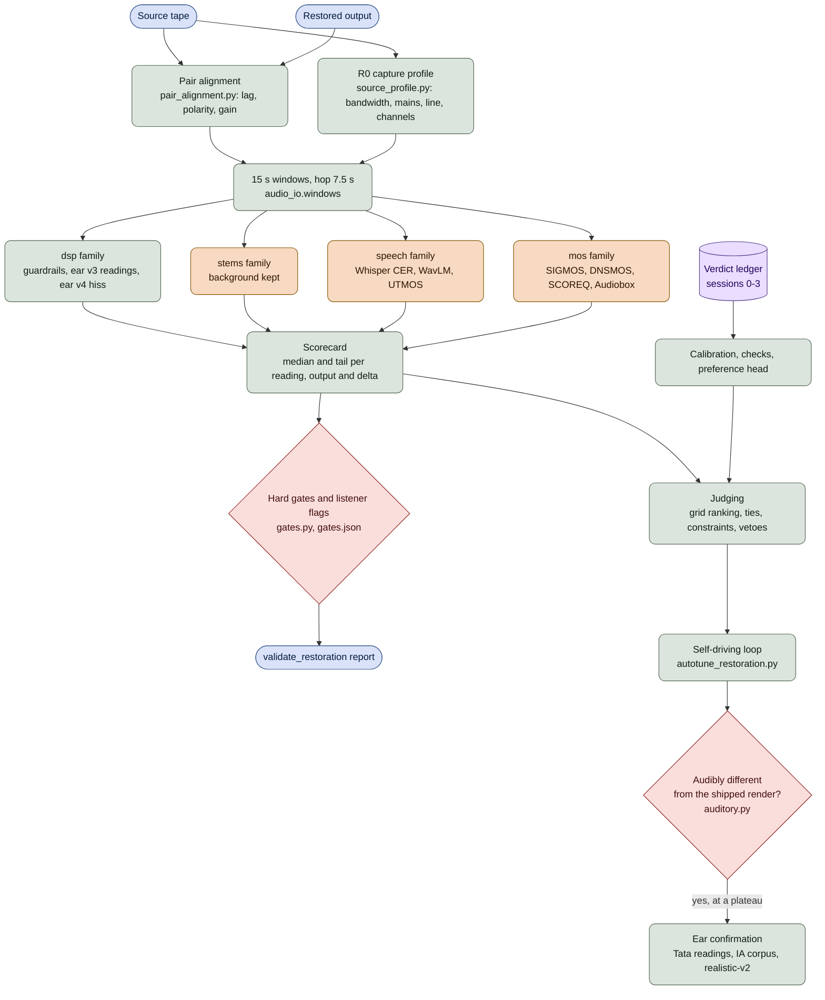
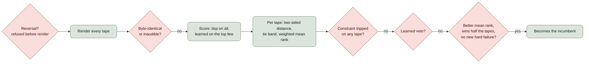
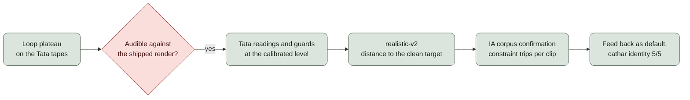

# The AI Human Ear: Architecture

The "AI human ear" is the output-quality harness: the code that listens to a
restored track against its own source and says what a listener would say. It
judges every restoration setting, drives the self-driving tuning loop and,
since 2026-10-30, decides alone: the user ended live listening ("no live
listening from me!! we rely only on ai human ear!!!"). It is calibrated on
the blind verdicts of sessions 0-3, ranks candidates by what the user
accepted there, and refuses to win by damaging the programme.

This page is the map. The rules and the measured facts behind every number
live in the output-quality-harness skill
(`.agents/skills/output-quality-harness/SKILL.md`), the hiss readings'
acceptance record in `docs/ear_v4_hiss.md`, ear v3's re-score in
`docs/ear_v3_round0.md`, and each engine setting's evidence in
`docs/configuration.md`.

## What It Must Do

- **Hear like the user.** Two-sided distance from what the user accepted,
  never "more is better": a brighter top read as better once, and the user
  heard +2 dB of air as thin.
- **Be very critical of VHS hiss** under speech or singing and in silence and
  pauses (the user's rule, 2026-10-11). Inaudible residual hiss is the
  target, with a heavy weight.
- **Never call dead air clean.** Silent pauses, an underwater "s" and dulled
  highs were all rejected by ear; hard guards keep a loop from winning by
  deleting programme.
- **Know when a difference is inaudible**, so an inaudible change ties and
  an audible one goes to the ear's own confirmation; nobody is asked to
  listen (2026-10-30).
- **Keep the family tapes on this machine.** No cloud judge, no audio LLM;
  the listening page of sessions 0-3 served on 127.0.0.1 only.

## The Whole Path

## Layer 1: Inputs and Alignment

| Module | Role |
|---|---|
| `scripts/validate_restoration.py` | Entry point: one source, labelled outputs |
| `restoration_quality/runner.py` | Loads, windows, runs families, aggregates |
| `restoration_quality/audio_io.py` | Loading, resampling, the windows |
| `scripts/pair_alignment.py` | Whole-file lag and polarity of each output |
| `restoration_quality/source_profile.py` | R0, what the capture carries |

Every paired reading sits on the aligner `pair_alignment.py` names in the
scored JSON: a head-only search read 68 of 205 cathar outputs more than 8
samples off. R0 reads the source once (cached per source and code hash): its
programme bandwidth, brickwall, mains frequency, line whistle and channel
state replace fixed 50 Hz / 15,625 Hz assumptions in every reading after it.

Windows are 15 s with a 7.5 s hop. Each reading is aggregated over the
windows as the median and the tail (the worst decile), on the output side and
as output minus source (`delta`).

## Layer 2: The Readings

Four families run in order, one model resident at a time; a family whose model
is missing is recorded as unavailable and never aborts the run, so the `dsp`
family alone needs neither torch nor a download.

### dsp: guardrails and ear v3

| Reading | Module | Hears |
|---|---|---|
| Residual noise, HF bands, clicks | `dsp_metrics.py` | Physical guardrails |
| R1 spectral balance | `balance_metrics.py` | Timbre moved, bright or dull |
| R2 sibilance | `sibilance.py` | The "s" kept its body |
| R4 pause residual | `pause_metrics.py` | Dead air, pause hiss shape |
| R7 gain ride, sync drift | `file_metrics.py` | Level riding, sync |
| R11 low end | `lf_metrics.py` | 40-200 Hz against the mids |
| R12 time base | `timebase_metrics.py` | Frame-for-frame playback |
| Transients | `transient_metrics.py` | Drum hits kept their edge |

R1 reads timbre on programme cells only (a cell 12 dB over its own floor on
the loud frames) with its own gain match, so a whole-spectrum tilt cannot hide
inside a level difference. A reading net of plain frames gets an absolute twin
(the sibilance band's `dsp.sib_abs_level_db` beside its net reading).

### dsp: ear v4, critical of hiss

| Module | Role |
|---|---|
| `hiss_floor.py` | Band layout, valley level, the source's hiss anchor |
| `hiss_programme.py` | Hiss left under the programme, over its mask |
| `hiss_pause.py` | Hiss-weighted pause floor over the quiet threshold |
| `hiss_stationary.py` | Second anchor for continuous programme |
| `pause_partials.py` | Leaves sung runs out of the pause reading |

Both hiss readings are read at one declared critical playback level, each
file's loud frames at 75 dB SPL (a calibrated listener's threshold-run level
plus 4 dB when `AI_RESTORE_LISTENER` names one,
`hiss_floor.critical_level_db`), and ranked one-sided with inaudible as the
target. `dsp.hiss_prog_excess_db` is the hiss under speech or singing over
its masked threshold; `dsp.hiss_pause_excess_db` is the hiss-weighted pause
floor over the threshold in quiet. The flags `listener.hiss_programme` and
`listener.hiss_pause` fire at 0 dB, a threshold no calibration moves
(`gates.USER_RULE_FIXED`).

The same module reads the guards that keep "no hiss" honest:

| Guard | Catches |
|---|---|
| `dsp.hiss_pump_db` | Pauses emptied while the programme keeps hiss |
| `dsp.hiss_prog_kept_hf_db` | Loud highs lost (dulling) |
| `dsp.hiss_prog_kept_soft_db` | Soft programme lost (consonants, tails) |
| `dsp.hiss_island_kurt` | Musical noise islands |
| `dsp.hiss_room_delta_db` | The room band emptied |

The dulling guard stands on its own floor: held no lower than each band's
quiet level 3 dB down, with the bands a perceptual coder thinned left out, or
a coded source's hiss peaks read as lost highs (2026-10-21).

### stems, speech, mos and judges

| Family | Module | Use |
|---|---|---|
| stems | `stem_metrics.py`, `stem_octave.py` | Background kept |
| speech | `speech_models.py` | Words, speaker, naturalness |
| mos | `mos_models.py` | SIGMOS, DNSMOS, SCOREQ, Audiobox |
| judges | `judges.py` | Zimtohrli, MERT |

Learned judges are 16 kHz or English-trained, and deaf above 8 kHz, so they
never enter the score: they only veto, past a multiple of their benign floor.
Everything above 8 kHz comes from native-rate DSP.

## Layer 3: Gates and Flags

`restoration_quality/gates.py` holds the hard gates as data: a reading, a
statistic, a comparison and a threshold. `scripts/calibrate_quality_metrics.py`
writes a `gates.json` that overrides the thresholds without touching code. A
gate is hand-set unless a calibration derived it, and a gates file can only
loosen a hand-set value. Some readings are display-only until a verdict sets
them (the old gap-level hiss flag, `speech.cer_median`, `mos.audiobox_pc`).

## Layer 4: The Auditory Model

`restoration_quality/auditory.py` decides whether two renders differ audibly:
alignment, a null test, then the noise-to-mask ratio per ERB band and frame
against the incumbent's masked threshold (spread excitation minus a 24 dB
offset, floored by the threshold in quiet). A pair is audible when some 15 s
window has 5 % of its frames over the mask, two event frames, or one frame
at +12 dB. `scripts/audibility_check.py` is its command line.

It is one-sided: "inaudible" is trusted, "audible" proves nothing about
better. Two consequences:

- The loop scores no candidate the model calls inaudible on every tape: it is
  a tie, never accepted.
- An audible plateau goes on to the ear's confirmation; nobody listens
  (2026-10-30). "Audible" alone decides nothing: torch 2.15's flagged
  Gaudeamus5 frames moved no ranked reading past 0.08 dB.

The model assumes the loud frames play at 65 dB SPL until a listener measures
it. A threshold run (`listen_ab threshold`) writes
`assets/quality_calibration/playback_calibration.jsonl`; with
`AI_RESTORE_LISTENER` set, the model takes that listener's playback level and,
since 2026-10-23, the shape of their thresholds frequency by frequency
(`listener_threshold_db`). The hiss readings keep the standard threshold
curve, critical by the user's rule.

## Layer 5: Judging Candidates

A grid (`scripts/tune_grids/tata_v4.yaml` for speech, `music_v4.yaml` for
music) declares how a group of candidates is judged:

| Section | Meaning |
|---|---|
| `ranking` | Readings with target, dead zone, scale, weight, tie |
| `constraints` | Hard guards: `worse`, `max_move`, `bound` |
| `vetoes` | Learned judges: a floor multiple |
| `reversals` | Moves past a ledger boundary the user rejected |
| `audibility` | The auditory model's tie |

The pieces, and who owns them:

| Module | Owns |
|---|---|
| `restoration_quality/reward.py` | Distance, tie band, constraints, win rates |
| `scripts/autotune_judging.py` | Ranking, ties, dead-zone floors, vetoes |
| `scripts/autotune_guards.py` | Reversals, audibility tie, constraints |
| `scripts/reward_noise_floor.py` | Test-retest noise of every reading |
| `scripts/same_percept.py` | Changes no listener can hear |

A reading's distance is `weight * max(0, |x - target| - dead_zone) / scale`.
Two candidates tie on a reading when their distances differ by less than its
noise: the test-retest jitter for hiss and noise readings (a fresh draw of the
same noise, a sub-sample delay, +-0.1 dB, a resampler round trip, 16-bit
requantisation), never the gross Session 0 benign pairs, which would blind the
ear to hiss. A tape counts as a win only when the candidate out-ranks the
incumbent and moved past the band the better way on some reading.

A constraint trips when the candidate is worse than its incumbent by more than
`max_move` and past `bound`, or worse and more than `max_move` past `bound`
whatever the incumbent read, so a loop cannot creep along a bound one
accepted round at a time.

## Layer 6: The Self-Driving Loop

`scripts/autotune_restoration.py` tunes one engine on whole tapes. Each round
proposes the neighbours of every knob's current value, the joint moves one
knob at a time cannot reach (`autotune_joint_moves.py`) and the combination of
every move that helped. Knobs the incumbent's switches make inert are never
rendered (`INERT_WHEN`, `autotune_material.py`). APL replays its neural stage
from a stage cache while only post-neural settings change.

The loop stops at a plateau: no candidate qualifies. `scripts/rejudge_autotune.py`
re-judges stored rounds offline when the judging changes;
`scripts/variation_precheck.py` asks whether a per-tape settings policy could
beat the single best preset audibly, the gate before any GRPO training.

## Layer 7: The Listener

| Module | Role |
|---|---|
| `scripts/listen_ab.py` | Serves a blind block on 127.0.0.1 |
| `restoration_quality/listen_cuts.py` | Aligned, levelled, faded cuts |
| `restoration_quality/listen_modes.py` | ABX, pair with "same", blend |
| `restoration_quality/listen_protocol.py` | Practice, catch trials, power |
| `restoration_quality/listen_threshold.py` | The hearing-threshold run |
| `restoration_quality/ledger.py` | The append-only verdict ledger |
| `restoration_quality/preference.py` | Bradley-Terry preference head |

A block plays 10 s cuts at one speech level (-23 dBFS), cut where the two
stimuli differ most audibly, switching at the same playhead. Every block
records the device and the volume. A replicate pair checks consistency; catch
trials (half the raw tape, and an air shelf) check engagement: a one-button
block reads "no signal", only a missed catch reads "disengaged". Every answer
appends to `assets/quality_calibration/verdicts.jsonl`; flags come only from
the user's own words.

The ledger closes the loop: verdicts falsify readings (a reading that orders a
verdict pair the wrong way past its noise is demoted), set the bounds of the
hard guards (the dulling and soft-programme bounds sit at the edge of the files
the user did not call dull), and feed the Bradley-Terry preference head.
`experiments/tata_listen/check_verdicts.py` checks the ear against every
verdict.

## Layer 8: Calibration and Confirmation

| Tool | Proves |
|---|---|
| `scripts/quality_degradations.py` | Single-factor damage moves its reading |
| `scripts/degradations_hiss.py` | Hiss moves under programme or in pauses |
| `scripts/calibrate_quality_metrics.py` | Readings move the right way, gates |
| `scripts/calibration_ordering.py` | Judged files ranked as heard |
| `scripts/check_hiss_fixtures.py` | Hiss readings on realistic-v2 |
| `scripts/confirm_trips.py` | A plateau's corpus confirmation table |

A reading is admitted only when it moves monotonically on its calibration
damage and stays inside its benign floor. A setting reaches a default only
through the whole chain below.

The corpus confirmation is where a Tata-only win is caught. On 2026-10-23
the cathar final the user preferred 36-0 tripped 57 of 235 IA clips; each
component rendered alone on the tripped clips named the split band and the
stronger subtraction, and a lighter candidate without them tripped 6. APL's
final passed (9 of 202) and became the default.

## Design Principles

1. Two-sided distance from what the user accepted; "more noise removed" is
   shown, never ranked.
1. Every net reading gets an absolute twin: a tilt cancels in any reading net
   of plain or loud frames.
1. Timbre on programme cells only, with its own gain match.
1. Read the capture before judging it (R0): bandwidth, mains, line.
1. Coverage before content: a reading reports how much it found.
1. Audibility before ranking: an inaudible difference is a tie.
1. Learned judges only veto.
1. Speech and music are judged by separate grids.
1. A reading is admitted by calibration and falsified by verdicts.
1. Hiss and noise readings take their ties from jitter, never from benign
   pairs; a bounded guard never follows the incumbent past its bound.

## Known Limits

- The auditory model over-predicts the audibility of small high-frequency
  changes under programme: the listener missed an air shelf it called audible
  at NMR 21-23 dB, yet a threshold run found normal hearing up to 12.5 kHz
  with loud frames near 84 dB SPL, so it is masking (the 24 dB offset leans
  towards audible), not hearing. That first run stalled on "can't tell"
  answers (bands about 45 dB wide) and is a forced choice since; a re-run is
  due before its calibration is used.
- On the realistic-v2 fixtures a perfect hiss removal still reads -19.6 dB of
  lost highs: their recorded noise holds bursts and crackle 18 dB over the
  steady hiss, which the dulling guard counts as programme.
- The pump guard trips on a few continuous-music IA clips (2 for APL, 4 for
  cathar's lighter candidate): the per-frame shelved fill empties the pauses
  while the suppressor leaves the music's hiss. The suppressor's own gain does
  not predict which clips (measured 2026-10-25); no fix yet.
- The reference suppressor's print is held up by continuous programme on
  advert breaks and film, costing 2-3 dB of loud highs on four IA clips.

## Where to Read More

- `.agents/skills/output-quality-harness/SKILL.md`: every reading, rule and
  measured fact, and how to run each tool.
- `.agent/workflows/tune_on_real_tapes.md`: the playbook from a listening
  complaint to a shipped default.
- `docs/ear_v4_hiss.md`: the hiss readings' acceptance record.
- `docs/ear_v3_round0.md`: ear v3's re-score of the stored listening files.
- `docs/configuration.md`: every engine setting with the evidence that set it.
